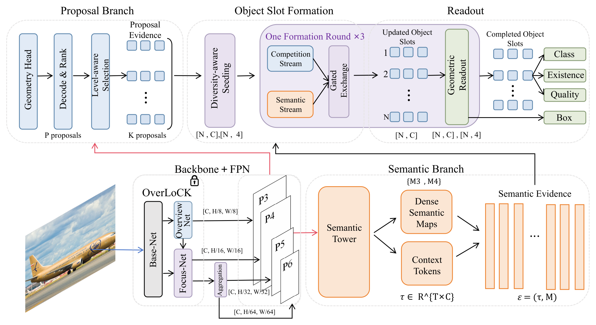
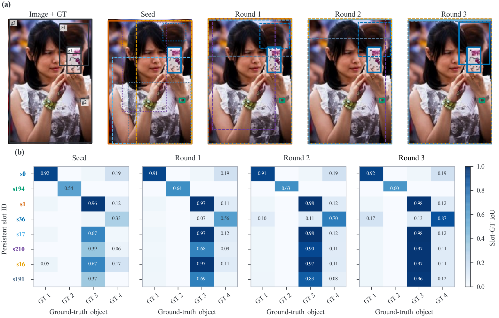
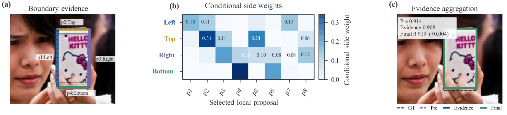
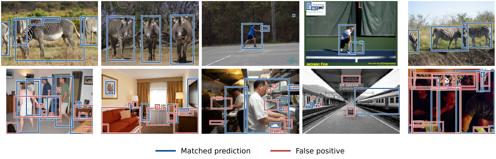

# EGO-Det: Evidence-Guided Object Slots for Decoupled Object Representation and Localization

**Manuscript submitted to *Neural Networks* (NN).** Submission status does not imply acceptance or publication.

> **Research code / pre-release.** The final non-EMA checkpoint has been strictly loaded and single-image GPU inference has been verified. Full COCO val2017 AP has not yet been independently reproduced from this cleaned repository. The following values are from the manuscript and historical experiment records.

## Abstract

Accurate object detection is a fundamental component of visual perception. Dense detectors provide extensive local geometric evidence, while query-based detectors represent candidate objects using compact prediction units. EGO-Det combines the advantages of these approaches by explicitly separating *localization support* from *object representation*. A persistent, class-agnostic proposal bank supplies geometric evidence, while object slots evolve into instance-level representations through diversity-aware initialization, semantic retrieval, and inter-slot competition. A slot-conditioned geometric readout then aggregates compatible proposals, estimates object boundaries independently, and refines the final boxes. With an OverLoCK-T backbone, EGO-Det reaches **45.3 AP on COCO val2017 after 12 training epochs**, without NMS. Transferring the slot branch onto frozen ATSS, FCOS, and RTMDet-M detectors yields paired AP improvements of +0.7, +0.5, and +0.5 points, respectively.

## Method overview



*Main framework of EGO-Det (manuscript Fig. 2). The persistent proposal bank and semantic evidence jointly support object-slot formation and geometric readout.*

## Results on COCO val2017

### Comparison with representative detectors

The figures are reported in the manuscript, **not independently recomputed by this GitHub checkout**. Compared models use different backbones and training schedules; the table is contextual, not a controlled architecture-only comparison.

| Method | Backbone | Epochs | NMS | AP | AP50 | AP75 | APs | APm | APl |
|---|---|---:|:---:|---:|---:|---:|---:|---:|---:|
| GFL | R50 | 12 | Yes | 40.2 | 58.4 | 43.3 | 23.3 | 44.0 | 52.2 |
| VFNet | R50 | 12 | Yes | 41.6 | 60.4 | 45.0 | 24.0 | 45.3 | 54.4 |
| TOOD | R50 | 12 | Yes | 42.4 | 61.5 | 46.1 | 24.7 | 46.1 | 55.5 |
| RTMDet-S | CSPNeXt-S | 300 | Yes | 44.6 | 61.9 | 48.1 | 24.9 | 48.5 | 62.5 |
| YOLOv6-S | EfficientRep-S | 300 | Yes | 45.0 | 61.8 | 48.9 | 24.3 | 50.2 | 62.7 |
| Sparse R-CNN | R50-FPN | 36 | No | 45.0 | 63.4 | 48.2 | 26.9 | 47.2 | 59.5 |
| Deformable DETR | R50 | 50 | No | 43.8 | 62.6 | 47.7 | 26.4 | 47.1 | 58.0 |
| SAM-DETR++ | R50 | 12 | No | 44.8 | 62.6 | 47.9 | 26.7 | 48.2 | 60.9 |
| DINO-5scale | R50 | 12 | No | 49.4 | 66.9 | 53.8 | 32.3 | 52.5 | 63.9 |
| YOLOv10-S | YOLOv10-S | 500 | No | 46.3 | 63.0 | 50.4 | 26.8 | 51.0 | 63.8 |
| **EGO-Det** | **OverLoCK-T** | **12** | **No** | **45.3** | **63.3** | **49.5** | **26.4** | **48.3** | **62.5** |

### Efficiency

| Params | FLOPs at 672 × 1024 | Latency | FPS | AP |
|---:|---:|---:|---:|---:|
| 47.0 M | 312.5 G | 218.91 ms | 4.6 | 45.3 |

Latency was measured on an RTX 4090, batch size 1, BF16 (manuscript Table 3). This is not an RTX 2080 Ti measurement.

### Cross-detector slot transfer (paper results)

| Frozen host detector | Native AP | Slot-output AP | ΔAP |
|---|---:|---:|---:|
| ATSS-R50 | 39.3 | 40.0 | +0.7 |
| FCOS-R50 | 37.1 | 37.6 | +0.5 |
| RTMDet-M | 47.0 | 47.5 | +0.5 |

These are paired results from detector-specific frozen-host experiments (manuscript Table 7), **not** outputs of the standalone OverLoCK-T checkpoint. The code in this repository currently focuses on the standalone EGO-Det mainline; ATSS/FCOS/RTMDet-M transfer implementations are not presented as runnable here.

### Inference-path interventions (same trained checkpoint)

These are **post-hoc interventions on the epoch-12 checkpoint**, not separately retrained model ablations. They reveal the dependence of the trained detector on each computation path (manuscript Tables 4–6).

<details>
<summary>Principal computation paths (Table 4)</summary>

| Variant | AP | AP50 | AP75 | ΔAP |
|---|---:|---:|---:|---:|
| w/o semantic completion | 1.65 | 2.51 | 1.77 | −43.62 |
| w/o slot competition | 41.42 | 58.36 | 45.49 | −3.85 |
| Frozen seed geometry | 42.62 | 62.99 | 47.18 | −2.65 |
| **EGO-Det (control)** | **45.27** | **63.33** | **49.48** | **0.00** |

</details>

<details>
<summary>Object-slot formation paths (Table 5)</summary>

| Variant | AP | AP75 | Matched mean IoU | Duplicate rate (%) | ΔAP |
|---|---:|---:|---:|---:|---:|
| Top-score seeding | 33.92 | 37.38 | 0.731 | 8.23 | −11.35 |
| Global semantics only | 30.57 | 33.25 | 0.772 | 0.70 | −14.70 |
| Regional semantics only | 28.49 | 31.52 | 0.757 | 0.81 | −16.78 |
| **EGO-Det (control)** | **45.27** | **49.48** | **0.771** | **0.88** | **0.00** |

</details>

<details>
<summary>Slot-conditioned geometric readout (Table 6)</summary>

| Variant | AP | AP75 | Matched mean IoU | ΔAP |
|---|---:|---:|---:|---:|
| Frozen seed geometry | 42.62 | 47.18 | 0.753 | −2.65 |
| Whole-box aggregation | 41.73 | 45.64 | 0.724 | −3.54 |
| w/o dustbin gating | 43.87 | 48.04 | 0.770 | −1.40 |
| w/o bounded residual | 45.14 | 49.37 | 0.768 | −0.13 |
| **EGO-Det (control)** | **45.27** | **49.48** | **0.771** | **0.00** |

</details>

## Installation

Recommended environment: Linux, Python 3.11, CUDA-capable GPU. PyTorch 2.1.2 with CUDA 11.8 and NumPy 1.26.4 were used for the verified local run.

```bash
conda create -n egodet python=3.11 pip -y
conda activate egodet
python -m pip install -r requirements.txt
python -m pip install -e . --no-deps
```

`requirements.txt` includes the CUDA 11.8 PyTorch wheels and PyYAML for config loading. For a different GPU/CUDA platform, install an appropriate PyTorch build first instead of forcing the cu118 wheel. The core path does not require MMDetection, MMCV, or custom CUDA compilation.

## Checkpoints and COCO data

The trained EGO-Det checkpoint is shared on **[Google Drive](https://drive.google.com/drive/folders/1vRUBt5aHNArzPT7uNBxwIZAfa4VbadPm?usp=sharing)**. Place `epoch_12.pth` under `checkpoints/`. The backbone is initialized from the pretrained **OverLoCK-T ImageNet-1K weights**, which should be placed under `weights/overlock/`. The pretrained backbone and the final EGO-Det detector weights are different files.

Expected local structure (all data and weights are Git-ignored):

```text
EGO-Det/
├── configs/egodet.yaml
├── checkpoints/epoch_12.pth
├── weights/overlock/overlock_t_in1k_224.pth
└── data/coco/
    ├── images/
    │   ├── train2017/          # COCO train2017 images
    │   └── val2017/            # COCO val2017 images
    └── raw/annotations/
        ├── instances_train2017.json
        └── instances_val2017.json
```

If COCO 2017 is **already downloaded elsewhere**, there is no need to duplicate the images. `tools/prepare_coco.py` creates local symbolic links to the existing train/val images and annotations:

```bash
# Check source layout without changing anything.
python tools/prepare_coco.py --source /path/to/COCO2017 --split all --dry-run
# Create the links (source may contain train2017/ and annotations/, or images/train2017/).
python tools/prepare_coco.py --source /path/to/COCO2017 --split all
```

There is **no offline annotation conversion or feature-extraction step** for the main model: COCO JSON is read directly by `ego_det_v2/data/coco_dataset.py`. For evaluation only, prepare `--split val` instead of `all`.

## Configuration

**Edit one active file: [`configs/egodet.yaml`](configs/egodet.yaml).** Both model hyperparameters and all dataset/checkpoint paths are read from this YAML when running the scripts below. Paths can be absolute or relative to the repository root.

```yaml
paths:
  train_annotations: data/coco/raw/annotations/instances_train2017.json
  val_annotations: data/coco/raw/annotations/instances_val2017.json
  image_root: data/coco/images
  overlock_weights: weights/overlock/overlock_t_in1k_224.pth
  checkpoint: checkpoints/epoch_12.pth
model:
  batch_size: 8            # training batch size
  grad_accum_steps: 2      # effective global batch size = 16 on one GPU
  num_workers: 8
  epochs: 12
  num_slots: 300
  bank_topk_train: 1000
  bank_topk_eval: 1500
  # ... all EgoDetV2Config fields are present in the YAML
training:
  smoke_steps: 0
evaluation:
  batch_size: 1            # independent eval DataLoader batch size
  num_workers: 0
  subset_size: 0           # 0 = all of val2017
demo:
  short_side: 384
  max_size: 640
  score_thr: 0.3
```

`model` contains every field of `EgoDetV2Config`, including geometry, slot formation, learning rates, schedules, losses and augmentation; editing it **affects new training runs**. Checkpoint evaluation and demo **restore the trained model structure from the checkpoint**, rather than replacing it with different training settings from YAML. The `evaluation` section controls evaluation-time behavior; `evaluation.model_overrides` may change only explicitly allowed inference options (`val_short_side`, `val_max_size`, `amp`, `amp_dtype`, `bank_topk_eval`). Changing these changes the evaluation protocol and may change AP.

Precedence: **explicit CLI options > YAML settings > code defaults**. A custom YAML can be selected with `--config /path/to/your.yaml`. The paper-style YAML includes `model.batch_size: 8`, intended for high-memory training; reduce it and adjust accumulation on memory-limited hardware. This changes optimization and cannot be called an exact paper reproduction.

## Training

Download COCO train2017 and val2017, prepare both splits, then execute:

```bash
python scripts/train.py --config configs/egodet.yaml
```

To temporarily override the YAML without editing it:

```bash
python scripts/train.py --config configs/egodet.yaml \
  --batch-size 2 --grad-accum 8 --epochs 12
```

Training uses AdamW, mixed precision where supported, warm-up, optional EMA, checkpointing, evaluation and resume; the underlying training loop is `ego_det_v2/engine/train_loop.py`. A smoke option is available with `--smoke-steps N`, but complete training and checkpoint resume have not been re-verified with the reorganized repository. Use a suitable GPU for paper-scale training.

## Evaluation (COCO val2017)

```bash
python scripts/eval.py --config configs/egodet.yaml
```

By default this reads the **raw, non-EMA** `epoch_12.pth` configured in `paths.checkpoint`, evaluates the full val2017 split (`subset_size: 0`), and writes `outputs/eval/predictions.json` (COCO detections) and `outputs/eval/metrics.json` (AP/AR metrics). For a limited functional check on a smaller GPU:

```bash
python scripts/eval.py --config configs/egodet.yaml \
  --batch-size 1 --num-workers 0 --subset-size 10
```

A 10-image subset is **not** comparable to the paper's full COCO AP. Any COCO evaluator failure raises an error instead of silently succeeding. Do not pass `--use-ema` when reproducing the paper's epoch-12 raw-model evaluation.

## Demo: single-image visualization

```bash
python scripts/demo.py --config configs/egodet.yaml \
  --image /path/to/image.jpg
```

The default output file is `outputs/demo_detection.jpg`. Visualization thresholds and output resolution can be configured in `demo:` or temporarily overridden with `--score-thr`, `--short-side` and `--max-size`. The diagnostic Demo displays **contiguous COCO class indices**, not category names, and does not apply NMS. This is independent of COCO evaluation.

## Qualitative visualizations

The following figures are taken from the supplied manuscript figures. They are illustrations of the method and its analysis, rather than new outputs generated from this GitHub checkout.

### Slot formation across rounds



*Persistent slot identities across three formation rounds (manuscript Fig. 5): local object hypotheses evolve towards more complete object representations.*

### Slot-conditioned boundary readout



*Boundary-wise evidence selection and the resulting geometric refinement (manuscript Fig. 6).*

### Detection examples



*Qualitative detections (manuscript Fig. 7). Blue boxes denote matched predictions; red boxes denote false positives.*

## Code structure

```text
configs/egodet.yaml             # active model/data/training/eval/demo settings
scripts/train.py                # train entrypoint
scripts/eval.py                 # COCO evaluation entrypoint
scripts/demo.py                 # single-image visualization entrypoint
tools/prepare_coco.py           # symlink existing COCO data
ego_det_v2/                   # checkpoint-compatible detector/engine/losses
egodet/                       # import API and inference implementation
assets/                       # manuscript figures shown above
```

## Acknowledgements

EGO-Det uses the [OverLoCK](https://github.com/LMMMEng/OverLoCK) backbone (Lou and Yu, 2025). We thank the OverLoCK authors for publicly releasing the model architecture and pretrained weights. Adapted upstream code is included under `ego_det_v2/backbones/overlock/` with the original **Apache License 2.0** text preserved. This third-party license does not automatically license the rest of EGO-Det.

**Release note:** The project-wide LICENSE and formal citation information should be finalized with all authors before changing this repository from private to public.
